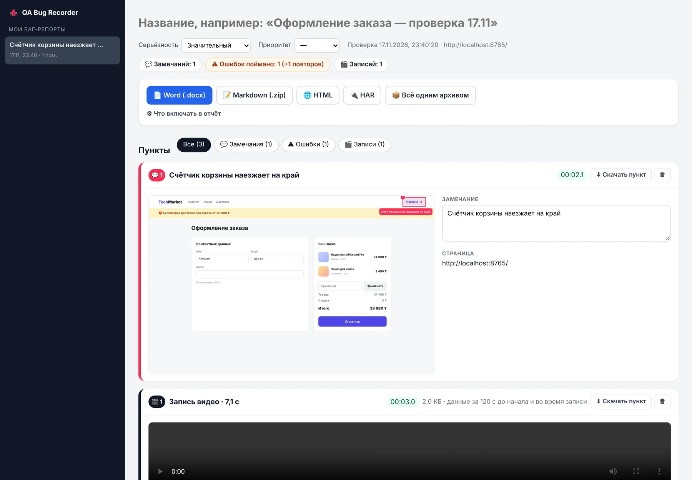

# 🐞 QA Bug Recorder

Расширение Chrome для тестировщиков: нашли баг, отметили элемент, нарисовали стрелку или наговорили голосом. Логи консоли, сетевые запросы и шаги воспроизведения уже собраны. Отчёт выгружается в **Word, Markdown, HTML или HAR**.

**Лендинг:** https://nurgeldiserikbay.github.io/chrome-testing-plugin/
**Скачать:** https://nurgeldiserikbay.github.io/chrome-testing-plugin/qa-bug-recorder.zip



## ⏪ Нашёл баг — задним числом

Заранее ничего включать не нужно. Пока вкладка с сайтом открыта, расширение помнит последние минуты (5, 10, 15 или 30 — выбирается в настройках, по умолчанию 10): действия, запросы, консоль, **повтор страницы** (rrweb — изменения DOM, а не видео) и **скриншоты после действий**. Заметили баг — нажмите **🐞 Нашёл баг** (или Ctrl+Shift+Q) и выберите период: 30 с, 1, 2, 5 минут или «всё, что помню». Ниже — «Что сохранить»: повтор экрана, скриншоты, шаги, консоль, запросы, события страницы (по умолчанию всё, выбор запоминается). Горячая клавиша сразу открывает этот выбор. В отчёт попадает пункт «⏪ Последние N» с плеером повтора, раскадровкой, **шагами воспроизведения** и всем контекстом, дальше можно отметить проблему стрелкой или рамкой. Во время долгой проверки то же самое — кнопкой «⏪ Сохранить последние».

**🤖 Автотест из последних действий** собирает шаги из того, что вы уже сделали за выбранный период: остаётся удалить лишнее и добавить проверки.

Повтор и скриншоты хранятся только в браузере, стираются при закрытии вкладки, секретные поля маскируются; оба выключаются в настройках.

## Как устроено

Тестировщик включает проверку (`Ctrl+Shift+Q` или «▶ Начать проверку») и работает с сайтом. Отчёт складывается из **пунктов** трёх видов, у каждого только свои данные:

- **⚠ Ошибка — автоматически.** Ошибка в консоли или запрос с ошибкой → пункт со скриншотом в этот момент, текстом ошибки, запросом (тело, заголовки, ответ сервера), действиями пользователя перед ошибкой, консолью и запросами рядом. Повторы считаются, а не дублируются.
- **💬 Замечание — вручную:** 🎯 элемент, ➚ стрелка, ▭ область, 💬 заметка → скриншот с выделением, текст, голос. Без технических логов.
- **🎬 Запись — по кнопке «Записать видео»:** видео + действия, события, запросы и консоль за время записи и 1–2 минуты до неё.

Любой пункт можно скопировать в буфер (📋 текст для задачи, скриншот или всё вместе) или выгрузить отдельно — одна задача в трекер на пункт. Ошибки чужих скриптов и сервисов не сохраняются, лишние ошибки можно игнорировать (🙈). Все данные сессии — в свёрнутом приложении отчёта.

**Серьёзность** у каждого пункта (🔴 блокирующий … ⚪ тривиальный): для ошибок подбирается автоматически по статусу запроса и действию пользователя, для замечаний выбирается при сохранении; в отчёте — фильтр и сортировка по серьёзности.

**🩺 Автопроверка сайта** — каждая открытая страница проверяется в фоне; в отчёте оценки (SEO, скорость, доступность, семантика, практики и безопасность) и список находок. SEO: noindex/robots.txt, title/description (длина, дубли), h1, canonical, viewport, Open Graph, schema.org. Скорость загрузки: блокирующие ресурсы, нет сжатия/кэша, тяжёлый JS, font-display, lazy-загрузка, HTTP/1.1, сторонние сервисы. Семантика: кликабельные div, ссылки-заглушки, кнопки без type в формах, неправильные type полей. Безопасность: битые ссылки и ресурсы, HTTPS, смешанный контент, заголовки безопасности, устаревшие API. А также: дублирующиеся запросы, повторная отправка форм, N+1, частый опрос, медленные и тяжёлые ответы; лишние перерисовки на любом сайте (элементы пересоздаются без изменений, пустые обновления DOM, постоянно меняющиеся области; для React — по компонентам); доступность через axe-core (описания на языке интерфейса); слишком большие и тяжёлые картинки; предупреждения React; Web Vitals и зависания. Для каждой находки — серьёзность, почему это плохо, как исправить, примеры. Страница проверяется кнопкой 🩺 на панели и при завершении.

## Возможности

- **🌐 8 языков интерфейса:** английский, испанский, казахский, китайский, немецкий, португальский, русский, французский — по языку браузера или вручную (меню расширения → Настройки → «Язык / Language»). Переводятся все экраны, панель на сайте, отчёты и выгрузки (Word, HTML, Markdown, Google Docs), ответы AI; тексты сайта и комментарии тестировщика остаются как есть. Лендинг тоже на 8 языках с переключателем. Переводы сделаны без носителей языка — правки приветствуются.
- **🤖 Автотесты из записи:** «Записать автотест» → пройти сценарий (клики, ввод, выбор, отметки) → поставить ✓ проверки (элемент виден, текст, значение поля, адрес) → сохранить. «▶ Запустить» прогоняет сценарии в отдельной вкладке: что прошло, что упало, на каком шаге, скриншот падения, ошибки консоли и упавшие запросы (по умолчанию тоже считаются падением). История прогонов, отчёт о прогоне в HTML, экспорт в Playwright (`.spec.ts` + конфиг), импорт/экспорт сценариев в JSON. Селекторы: `data-testid` → `id` → `name`/`aria-label`/`placeholder` → текст → путь.
- **🔗 Связанные сценарии:** любой сценарий можно вставить шагом «▶ Выполнить сценарий» в другой — например, «Вход» в начало «Оформления заказа». Так нужное состояние страницы создаёт сам прогон. Если сценарий начинается там, где заканчивается другой, расширение предлагает подключить его как начало. В результатах прогона вложенные шаги показаны деревом, а падение — с указанием, в каком сценарии. Защита от циклов; в Playwright вызываемые сценарии становятся функциями.
- **🔌 API-тесты по Swagger/OpenAPI и Postman:** импорт файла, ссылки или текста (OpenAPI 2/3 в JSON и YAML, Postman 2.x). Окружение проекта: базовый адрес, авторизация (Bearer, Basic, API-ключ, cookie сайта, свои заголовки, «взять токен из открытой вкладки»), переменные. Для каждого эндпоинта автоматически: правильный запрос (статус, ответ по схеме, время), нет обязательных полей, неверные типы, null, длинные строки, неверный формат и enum, пустое тело, битый JSON, обязательные параметры, несуществующий и некорректный id, без авторизации и с неверным токеном. Цепочки: CRUD по схеме (создать → получить → изменить → проверить сохранение → удалить → получить/удалить/изменить удалённое) и порядок запросов коллекции Postman с переменными (`pm.environment.set` распознаётся). Изменяющие запросы — только при отметке «тестовый стенд». Итог — «Что не так с API» с объяснениями и советами, запросы и ответы по каждой проверке, HTML/Markdown, разбор AI.
- **🧪 Подмена ответов API** (fetch и XHR): вернуть статус и тело, задержать, «нет сети»; правило по части адреса (можно `*`), методу и сайту; настоящий ответ с вкладки можно взять за основу. На странице видна плашка, подменённые запросы помечены 🧪 и не становятся «ошибками».
- **📶 Условия:** сеть (4G, 3G, медленный 3G, нет сети), процессор ×4/×6, устройства (iPhone, Android, iPad, ноутбук, монитор) — через DevTools-протокол; условия записываются в каждый пункт. **📐 Экраны:** скриншоты страницы на 375/768/1280/1920 px пунктами в отчёт.
- **🔎 Сводка проблем** сверху отчёта: ошибки JS и запросов, сообщения об ошибках на экране, зависания, плохие Web Vitals, частые перерисовки.
- **🕒 Таймлайн:** действия, сеть, консоль, изменения DOM, рендеры и события страницы на одной шкале времени, с фильтром «Важное».
- **⚡ Производительность:** Web Vitals (LCP, INP, CLS, FCP, TTFB), долгие кадры с виновным скриптом, медленные клики, сдвиги макета, графики FPS, памяти и DOM-узлов. В режиме DevTools — пересчёты layout и стилей, время JS.
- **🔁 Лишние перерисовки — на любом сайте:** элементы, которые пересоздаются с тем же содержимым, пустые обновления атрибутов и текста, постоянно меняющиеся области. Для React дополнительно — какие компоненты и сколько раз рендерились (хук React DevTools; отключается в настройках).
- **🧩 События страницы:** появившиеся тосты и модалки, ошибки валидации форм, `alert`/`confirm`, прокрутка, фокус, потеря сети, WebSocket, изменения `localStorage`.
- **🍪 Снимок в момент бага:** cookies, localStorage, sessionStorage, сеть пользователя, тема, часовой пояс, экран.
- **🤖 AI-разбор** (Claude, OpenAI или любой OpenAI-совместимый сервис, по своему ключу): у пункта — заголовок, шаги, ожидалось / фактически, вероятная причина (фронтенд или бэкенд), что проверить, предложенная серьёзность; для отчёта — резюме «что исправлять первым». Разбор попадает в выгрузку. Без ключа — копирует готовый запрос для чата.
- **📄 Google Docs:** отчёт или пункт сразу Google-документом в папке «QA Bug Recorder» на Диске (доступ только к своим файлам, `drive.file`), видео и голос — рядом. Без настройки — копирует отчёт и открывает новый документ.
- **Экспорт:** Word (.docx), Google Docs, Markdown (.zip со скриншотами и медиа), HTML (один файл, видео внутри), HAR, всё одним архивом.
- **Приватность.** Всё хранится локально; во внешние сервисы (AI, Google) данные уходят только по нажатию кнопки. Пароли и карты не записываются, токены и cookie скрываются при экспорте.
- **История отчётов** и горячие клавиши.
- **Первый запуск:** страница приветствия объясняет, какие данные собираются и куда уходят; проверка не начнётся без согласия. Разрешение `debugger` (эмуляция сети и устройств, скриншоты экранов, полный захват сети) используется только при включении этих функций; Chrome не разрешает делать его необязательным.
- **❤ Поддержать разработку** — кнопка в меню расширения и раздел на лендинге.

## Установка

1. Скачайте [qa-bug-recorder.zip](https://nurgeldiserikbay.github.io/chrome-testing-plugin/qa-bug-recorder.zip) или склонируйте репозиторий.
2. Откройте `chrome://extensions`, включите **«Режим разработчика»**.
3. **«Загрузить распакованное расширение»** → папка `qa-bug-recorder` (или `extension/` из репозитория).
4. Обновите вкладки тестируемого сайта.

Подробная инструкция: [extension/INSTALL.md](extension/INSTALL.md).

| Клавиши | Действие |
|---|---|
| `Ctrl+Shift+Q` | Начать проверку / открыть панель |
| `Alt+Shift+E` | Выбрать элемент |
| `Alt+Shift+A` | Стрелка |
| `Alt+Shift+S` | Готово, открыть отчёт |

## Структура репозитория

```
extension/              код расширения (Manifest V3, без сборки и зависимостей)
  manifest.json
  background.js         service worker: буфер, сессии бага, скриншоты, DevTools-протокол
  inject.js             MAIN world: перехват console, ошибок, fetch, XHR
  probe.js              MAIN world: события страницы, DOM, Web Vitals, кадры, ресурсы, WebSocket, storage
  react-probe.js        MAIN world: счётчик перерисовок React (подключается по настройке)
  rr.js                 MAIN world: повтор страницы (rrweb, MIT) для «Нашёл баг»
  bridge.js             контент-скрипт: действия пользователя, передача данных, скриншоты после действий
  retro-bg.js           фон: буфер повтора и скриншотов, «Нашёл баг», автотест из последних действий
  overlay.js            панель проверки поверх страницы
  offscreen.js          запись видео вкладки и микрофона
  popup.*               окно расширения
  report.*              страница отчёта и история
  exporters.js          HTML / Markdown / DOCX / HAR
  integrations.js       AI-разбор (Claude / OpenAI-совместимые) и выгрузка в Google Drive/Docs
  settings.html/js/css  страница «🔌 Интеграции»
  docx.js, zip.js       генерация .docx и .zip без библиотек
  db.js                 IndexedDB
  i18n.js, i18n/*.js    перевод интерфейса: исходные строки русские, словари en/zh/es/pt/fr/de/kk
  _locales/             название и описание для Chrome Web Store
  welcome.html/js       первый запуск: какие данные собираются, согласие
  vendor/rrweb/         плеер повтора для отчёта и выгрузок (MIT)
  vendor/axe.min.js     axe-core (MPL-2.0) — проверка доступности, vendor/axe-ru.json и vendor/axe-locales/ — локализации
docs/                   лендинг (GitHub Pages): index.html и privacy.html на русском, <язык>/ — переводы
store/                  всё для Chrome Web Store: описания, обоснования разрешений, скриншоты 1280×800
.github/workflows/      публикация лендинга и архива расширения
```

## Разработка

Сборка не нужна: после изменений нажмите «Обновить» у расширения в `chrome://extensions` и перезагрузите вкладку сайта.

Лендинг и `qa-bug-recorder.zip` публикуются автоматически при пуше в `main` (workflow `pages.yml`). Для первого запуска в **Settings → Pages → Build and deployment → Source** выберите **GitHub Actions**.

## Ограничения

- Видео с панели на странице Chrome разрешает включить, только если баг начат через иконку или горячую клавишу на этой вкладке и после этого не было перехода на другую страницу. Иначе нажмите иконку → «⏺ Видео».
- Видео в формате WebM. В Word оно не встраивается и прикладывается отдельным файлом.
- Повтор страницы — это запись изменений DOM, а не видео: содержимое canvas, видео на странице и картинки, которые сайт уже удалил с сервера, в повторе не видны. Для таких случаев есть «⏺ Видео».
- Повтор и скриншоты начинаются с загрузки страницы после установки или обновления расширения.
- На служебных страницах `chrome://` и в Chrome Web Store расширения не работают.

## Лицензия

[MIT](LICENSE): можно свободно использовать, изменять и распространять, в том числе в коммерческих проектах, с сохранением уведомления об авторских правах.
